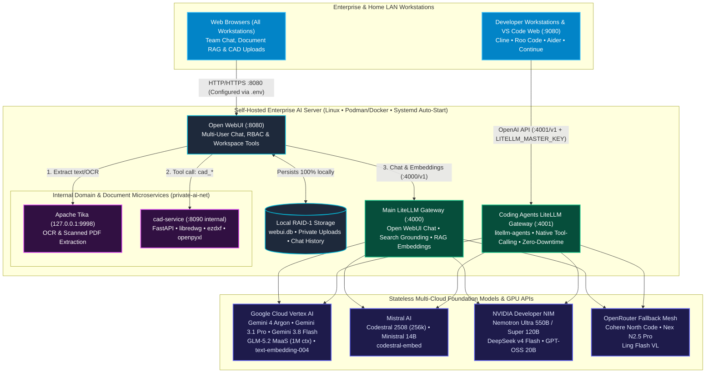
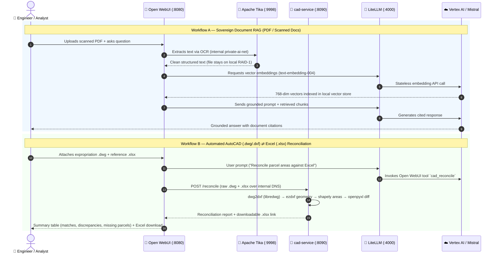

[English](README.md) | [Română](README.ro.md) | [Français](README.fr.md)

---

# Private Enterprise AI Hub 🏢🤖

> **Production-Grade Sovereign Enterprise AI Platform, Dual LiteLLM Gateways, Custom Microservices & Turnkey DevSecOps Automation**  
> Open WebUI (`:8080`) • Main AI Gateway (`litellm :4000`) • Dedicated Coding Agents Gateway (`litellm-agents :4001`) • Google Cloud Vertex AI (Gemini 3.1 Pro, 3.8 Flash, GLM-5.2 1M MaaS) • Mistral Codestral • NVIDIA NIM • Apache Tika OCR • Custom FastAPI CAD Microservice (`cad-service`)

[](LICENSE)
[]()
[-4A90E2?style=flat-square)](litellm-agents/README.md)
[]()
[]()
[-0A66C2?style=flat-square&logo=linkedin)](https://www.linkedin.com/in/marian-rop)
[](https://www.credly.com/users/marian-ropota/badges/credly)

A complete, self-hosted **Enterprise AI Platform** combining **end-to-end reference architecture**, **custom Python/FastAPI microservices**, **isolated multi-workstation AI gateways**, and **zero-touch Linux `systemd` deployment automation** (`./run.sh` & `./litellm-agents/run.sh`).

Designed for **enterprises, engineering teams, and multi-workstation labs** requiring strict **data sovereignty (GDPR / ISO 27001 alignment)**: all sensitive contracts, financial spreadsheets, AutoCAD drawings (`.dwg`/`.dxf`), and conversation databases remain **100% on local redundant storage (RAID-1)**, while foundation model inference is governed through stateless, authenticated multi-cloud APIs (**Google Vertex AI Gemini 3.1 Pro / 3.8 Flash / Zhipu GLM-5.2 1M-Context MaaS, Mistral Codestral 2508, NVIDIA NIM, and OpenRouter**).

---

## 🎯 Executive Summary — Why This Project Matters (For Managers, HR & Architects)

### 👔 For Engineering Managers, CTOs & FinOps Decision Makers
- **70%–85% AI Cost Reduction (Eliminate Per-Seat SaaS Sprawl):** Instead of paying $20–$60/user/month across separate ChatGPT, Copilot, and Cursor seats, the entire organization shares centralized **pay-per-token LiteLLM API Gateways** with automatic failover to zero-cost and open-weight models.
- **High-Availability Dual-Gateway Isolation (`litellm` vs. `litellm-agents`):**
  - **Business & Knowledge Portal (`litellm :4000` + `Open WebUI :8080`):** Serves cross-functional teams with document RAG, OCR, CAD automation, and live Google Search grounding.
  - **Software Engineering Gateway ([`litellm-agents :4001`](litellm-agents/README.md)):** Dedicated proxy for autonomous IDE coding agents (**Cline, Roo Code, Aider, Continue**) accessible from all authorized developer workstations on the LAN/VPN—ensuring web-UI redeployments never interrupt active coding sessions and native IDE tool-calling never conflicts with web search grounding.
- **100% Local Data Sovereignty & IP Protection:** Uploaded PDFs, Excel workbooks, AutoCAD files, and SQLite databases never leave your on-premises server (`RAID-1`). Cloud providers act strictly as stateless reasoning engines with zero training retention.
- **Zero-Trust `.env` Configuration & Linux Boot Resilience:** All ports, network bind IPs, container settings, GCP Service Account paths, and API keys live exclusively in `chmod 600` `.env` files (never hardcoded), backed by automated Linux `systemd` boot services (`private-ai.service` & `litellm-agents.service`).

### 🤝 For HR, Talent Acquisition & Hiring Managers (Skills & Role Alignment)
This repository is not a theoretical tutorial—it is a **live, production-hardened enterprise system** designed, coded, and operated end-to-end. Below is a quick reference for recruiters and hiring managers evaluating hands-on capabilities:

| Core Enterprise Competency | Concrete Proof in This Repository | Target Roles Aligned |
|---|---|---|
| **Enterprise AI & LLM Gateway Architecture** | Dual **LiteLLM Gateways** (`:4000` & `:4001`) routing across **Google Vertex AI (Gemini 3.1 Pro, 3.8 Flash, GLM-5.2 MaaS)**, **Mistral (Codestral 2508)**, **NVIDIA NIM (Nemotron 550B, DeepSeek v4)**, and **OpenRouter** with automated retry/fallback chains. | *Principal AI Architect • GenAI Platform Lead • LLMOps Architect* |
| **Security, Governance & DevSecOps (12-Factor)** | Complete secret & network parameterization via `.env` (`chmod 600`), GCP IAM Service Account auto-refresh (eliminating 60-min OAuth token expiry), internal-only microservice isolation (`private-ai-net`), and hardened `.gitignore` controls. | *AI Governance Lead • Cloud Security Architect • DevSecOps Engineer* |
| **Backend Python & Domain Microservices** | Custom containerized **FastAPI microservice** (`cad-service/app.py`) performing automated AutoCAD `.dwg`/`.dxf` geometry extraction (`libredwg`, `ezdxf`, `shapely`) and Excel reconciliation (`openpyxl`), integrated via custom **Open WebUI Tools** (`cad_tool.py`). | *Senior Python / AI Backend Engineer • Solutions Architect* |
| **Production Linux, Containers & SRE** | Multi-container **Podman/Docker** orchestration, **Linux `systemd` boot automation**, Netavark/firewalld DNS synchronization, **RAID-1** persistent storage management, and zero-CPU cloud-assisted RAG (**Apache Tika OCR** + **Vertex `text-embedding-004`**). | *Staff Platform / Infrastructure Engineer • MLOps / SRE Lead* |

### 🏛️ For AI & Cloud Solution Architects (System Design Highlights)
- **Dual-Gateway Separation Pattern:** Solves two real-world production pain points: (1) container lifecycle coupling between chat UIs and IDE agents, and (2) schema collisions between Vertex AI `googleSearch: {}` grounding and autonomous agent function-calling (`read_files`, `editor`, `execute_command`).
- **1M-Token Agentic Coding via Vertex AI MaaS ([`glm5.2.md`](litellm-agents/glm5.2.md)):** Integrates **Zhipu GLM-5.2 (`zai-org/glm-5.2-maas`)** on Google Cloud Vertex AI with background Service Account IAM token rotation for uninterrupted multi-hour coding sessions.
- **Zero-CPU Local RAG Pipeline:** Decouples **Apache Tika (`:9998`)** for OCR/document extraction from **Vertex AI `text-embedding-004` (768-dim)** for vectorization—achieving sub-second semantic search without local GPU/CPU bottlenecks.
- **Air-Gapped Domain Tool Microservice (`cad-service`):** Runs on the internal container bridge (`private-ai-net`, port `8090` unexposed to host) and is invoked by the LLM via Open WebUI tool-calling.

---

## 🏗️ System Architecture Diagrams

### 1. End-to-End Enterprise AI Hub & Dual-Gateway Topology



### 2. Sovereign Document RAG & CAD Reconciliation Flow



---

## 🚀 Key Features

- **💬 Beautiful Web Interface:** ChatGPT-like UI via Open WebUI
- **🌐 Real-Time Web Search:** Built-in internet search using DuckDuckGo (Open WebUI) + Google Search grounding (LiteLLM/Vertex AI)
- **📚 Local RAG (Retrieval-Augmented Generation):** Upload PDFs and documents; the AI searches and cites them using **Google's text-embedding-004** (cloud-based, no local CPU overhead)
- **💾 Full Chat History:** All conversations saved locally on RAID 1; completely private
- **🤖 Multi-Model Hub (Google Vertex AI + Mistral AI):** 
  - **Codestral (codestral-2508)** — specialized for coding, refactoring, FIM, 256k context (Roo Code / Cline / Open WebUI)
  - **Gemini 3.1 Pro Preview** — advanced reasoning, complex queries
  - **Gemini 3.8 Flash** — instant responses, 1-3 seconds, perfect for daily use
  - **Ministral 14B** — general purpose, fast European AI model
  - *Full details & IDE configuration guide: [litellm.md](litellm.md)*
- **📄 Smart PDF Processing:** Automatic OCR via Apache Tika (scanned PDFs, images in documents)
- **📐 CAD & XLSX Reconciliation (opt-in):** Extract surfaces from AutoCAD `.dwg`/`.dxf`, export to Excel, reconcile against cadastral reference tables — built for road expropriation workflows. See [CAD_README.md](CAD_README.md).
- **🔐 Multi-User Isolation:** Each user sees only their own files; admin panel for configuration
- **🚀 Auto-Start:** Systemd service ensures containers restart after server reboot
- **🔐 Secure Authentication:** GCP Service Account credentials; no API keys stored in code
- **🐳 Container-based:** Easy deployment with Podman; everything runs in containers

---

## 📋 What's Inside (Updated October 2026)

### Current Pinned Versions & Gateways

| Component | Image / Package | Tag / Version | Default Port (`.env`) | Purpose |
|-----------|-----------------|---------------|-----------------------|---------|
| **Open WebUI** | `ghcr.io/open-webui/open-webui` | `v0.12.3` | `8080` (`OPEN_WEBUI_PORT`) | Enterprise Chat UI, RBAC & RAG Workspace |
| **LiteLLM (Main Hub)** | `ghcr.io/berriai/litellm` | `main-latest` | `4000` (`LITELLM_PORT`) | Open WebUI Proxy, Search Grounding & RAG Embeddings |
| **LiteLLM Agents Gateway** | `ghcr.io/berriai/litellm` | `main-latest` | `4001` (`LITELLM_AGENTS_PORT`) | Dedicated Coding Agents Gateway (`Cline`, `Roo Code`, `Aider`) |
| **Apache Tika** | `docker.io/apache/tika` | `latest` | `127.0.0.1:9998` (`TIKA_PORT`) | Internal OCR & Scanned PDF Text Extraction |
| **CAD Microservice** | `cad-service:local` (FastAPI) | `local` | `8090` (Internal only) | Automated AutoCAD `.dwg`/`.dxf` & Excel `.xlsx` Reconciliation |
| **code-server (VS Code)** | Native RPM (`coder/code-server`) | `v4.137.0+` | `9080` | Browser-based IDE + Cline & Roo Code AI Agents |

See [Version Management & Upgrades](#-version-management--upgrades) below for the full workflow to change these versions.

### Component Overview

**Multi-LLM Models (via LiteLLM `:4000` & `litellm-agents` `:4001`):**
- **Zhipu GLM-5.2 (`zai-org/glm-5.2-maas` on Vertex AI)** — 1M token context window, top-tier autonomous software engineering & reasoning (see [litellm-agents/glm5.2.md](litellm-agents/glm5.2.md))
- **Codestral (`codestral-2508`)** — Specialized coding model (256k context), IDE AI agent (Roo Code / Cline)
- **Gemini 3.1 Pro Preview** — Deep reasoning, complex system architecture, multimodal analysis
- **Gemini 3.8 Flash** — Instant responses (1-3 sec), real-time web search, daily chat & fast agentic loops
- **NVIDIA NIM & OpenRouter Fallbacks** — Nemotron Ultra 550B, DeepSeek v4 Flash, Cohere North Code

**Smart Document Processing:**
- **Apache Tika** — OCR and text extraction from scanned PDFs, images, and complex documents
- **Google text-embedding-004** — Cloud-based embeddings (768 dimensions) replaces local CPU-heavy models
  - No CPU blocking during document upload
  - Faster, more accurate semantic search

**Multi-User & Multi-Workstation Governance:**
- **Admin user** — Full access to system config and all users' files
- **Regular users** — See only own files; cannot access other users' documents
- **Multi-Computer LAN / Enterprise Access (`.env`)** — All ports (`OPEN_WEBUI_PORT`, `LITELLM_PORT`, `LITELLM_AGENTS_PORT`) and bind IPs (`0.0.0.0` for LAN-wide workstation access or `127.0.0.1` for local-only) are managed in `.env` (`chmod 600`) and excluded from Git

**System Reliability & Network:**
- **Dual Systemd Autostart** — Both `private-ai.service` (main stack) and `litellm-agents.service` (coding gateway) automatically start at Linux boot
- **Fixed session key** — Browser sessions remain valid across restarts
- **RAID 1 storage** — 3.7TB redundant storage for chat history and documents
- **Netavark Firewall Sync** — Automated systemd firewall synchronization ensuring Podman container DNS works continuously across firewall reloads

**Autonomous Development & Remote Coding ([`litellm-agents/`](litellm-agents/README.md)):**
- **Dedicated Coding Gateway (`litellm-agents` on `:4001`)** — Isolated from Open WebUI so redeploying chat containers never interrupts active coding sessions, and Vertex AI Gemini/GLM-5.2 models run with pure native function-calling
- **VS Code Server (`code-server`) & LAN IDEs** — Connect Cline, Roo Code, Cursor, or Aider from any authorized computer on the network via `http://<SERVER_IP>:4001/v1` (see [litellm-agents/README.md](litellm-agents/README.md) and [litellm-agents/glm5.2.md](litellm-agents/glm5.2.md))

---

## 🔧 Version Management & Upgrades

All container image tags are declared as variables at the top of [run.sh](run.sh). To change any version, edit those variables and re-run the script.

### Where versions are pinned

`run.sh` (lines 65–67):

```bash
OPEN_WEBUI_IMAGE="ghcr.io/open-webui/open-webui:v0.12.3"
LITELLM_IMAGE="ghcr.io/berriai/litellm:main-latest"
TIKA_IMAGE="docker.io/apache/tika:latest"
```

`run.sh` always calls `docker pull` on each image before recreating containers, so a re-run with unchanged variables refreshes rolling tags (`main-latest`, `latest`) and a re-run with a bumped `OPEN_WEBUI_IMAGE` downloads and deploys the new pinned version.

### Open WebUI Release History

| Date | From → To | Notes |
|------|-----------|-------|
| 2026-09-06 | `main` (0.11.0) → `v0.11.3` | Pinned to stable. Fixes DB migration bug from 0.11.0–0.11.2. |
| 2026-10-18 | `v0.11.3` → `v0.12.3` | Major feature release: E2E encrypted chats, realtime voice, lighter Redis streaming |

### How to upgrade Open WebUI

1. Check the latest stable release: <https://github.com/open-webui/open-webui/releases>
2. Read the release notes for breaking changes and DB migration warnings.
3. **Backup the data volume** (see [Backup & Restore](#-backup--restore) below).
4. Edit `OPEN_WEBUI_IMAGE` in `run.sh` to the new tag.
5. Run `./run.sh` — it will pull the new image, run migrations automatically, and restart.

### Tag Semantics

| Tag | Meaning | Recommended Use |
|-----|---------|-----------------|
| `vX.Y.Z` | Pinned stable release (e.g. `v0.12.3`) | ✅ Production / Enterprise use. Reproducible. |
| `latest` | Always the latest stable release | Auto-track stable; less predictable. |
| `main` | Bleeding edge dev branch | Not recommended; may include broken commits. |

---

## 🚀 Deploy Modes & Redeploy Workflow

Three supported operations, all driven by the same `run.sh`.

### Mode 1 — First-time deploy (fresh install)

Prerequisites: `docker` or `podman` installed, GCP Service Account JSON ready, RAID mount available at `/mnt/raid1` (or edit the `RAID_STORAGE` path in `run.sh`).

```bash
git clone <this-repo> /opt/private-ai-hub
cd /opt/private-ai-hub

# 1. Place your GCP credentials
cp /path/to/service-account-key.json ./${GCP_CREDENTIALS_FILE:-credentials.json}
chmod 600 credentials.json

# (Optional) If you want to use a different filename for your credentials, 
# you can configure it via a .env file:
# echo "GCP_CREDENTIALS_FILE=${GCP_CREDENTIALS_FILE:-my-custom-key.json}" > .env

# 2. Edit litellm_config.yaml with your GCP project ID
$EDITOR litellm_config.yaml

# 3. Deploy
chmod +x run.sh
./run.sh

# 4. (Recommended) Enable systemd autostart — see "Auto-Start Containers" below
```

Open http://localhost:8080, create the admin account.

### Mode 2 — Redeploy (unchanged config, refresh images / restart)

Use this after editing `litellm_config.yaml`, after a system reboot, or to pull rolling-tag updates for LiteLLM/Tika.

```bash
cd /opt/private-ai-hub
./run.sh
```

`run.sh` is idempotent: it does `docker rm -f` on existing containers and recreates them. Data on the RAID volume is untouched.

### Mode 3 — Upgrade Open WebUI to a new version

See [How to upgrade Open WebUI](#how-to-upgrade-open-webui-to-a-newer-release) above. TL;DR:

```bash
# 1. Backup
STAMP=$(date +%Y%m%d-%H%M%S)
tar -czf /mnt/raid1/podman-volumes/backups/open-webui-data-pre-upgrade-$STAMP.tar.gz \
  -C /mnt/raid1/podman-volumes open-webui-data

# 2. Edit run.sh → bump OPEN_WEBUI_IMAGE tag
$EDITOR run.sh

# 3. Redeploy
./run.sh

# 4. Verify (see below)
```

### Post-deploy verification

Every deploy should end with these 4 checks:

```bash
# a) All 3 containers up
docker ps --format 'table {{.Names}}\t{{.Image}}\t{{.Status}}'

# b) Open WebUI version matches the pinned tag
docker exec open-webui cat /app/package.json | grep '"version"'

# c) HTTP endpoint healthy
curl -s -o /dev/null -w 'HTTP %{http_code}\n' http://localhost:8080/health

# d) DB migrations ran cleanly (no errors/traceback)
docker logs open-webui 2>&1 | grep -iE 'error|traceback|alembic' | tail -20
```

Expected: 3 containers `Up`, version matches `OPEN_WEBUI_IMAGE` tag, HTTP 200, no tracebacks.

### Rollback

If the upgrade breaks the app:

```bash
# 1. Stop containers
docker stop open-webui litellm tika

# 2. Restore the pre-upgrade backup
rm -rf /mnt/raid1/podman-volumes/open-webui-data
tar -xzf /mnt/raid1/podman-volumes/backups/open-webui-data-pre-upgrade-<STAMP>.tar.gz \
  -C /mnt/raid1/podman-volumes

# 3. Revert OPEN_WEBUI_IMAGE in run.sh to the previous tag, then redeploy
$EDITOR run.sh
./run.sh
```

---

## 💾 Backup & Restore

All persistent state lives in `/mnt/raid1/podman-volumes/open-webui-data` (SQLite DB, uploads, vector DB, cache). LiteLLM and Tika are stateless.

**Backup (safe to run while containers are up, but consistent snapshots require stop):**

```bash
STAMP=$(date +%Y%m%d-%H%M%S)
docker stop open-webui   # optional but recommended for a consistent snapshot
tar -czf /mnt/raid1/podman-volumes/backups/open-webui-data-$STAMP.tar.gz \
  -C /mnt/raid1/podman-volumes open-webui-data
docker start open-webui
```

**Restore:**

```bash
docker stop open-webui
rm -rf /mnt/raid1/podman-volumes/open-webui-data
tar -xzf /mnt/raid1/podman-volumes/backups/open-webui-data-<STAMP>.tar.gz \
  -C /mnt/raid1/podman-volumes
docker start open-webui
```

**Backup rotation** (keep last 5, run from cron):

```bash
ls -1t /mnt/raid1/podman-volumes/backups/open-webui-data-*.tar.gz | tail -n +6 | xargs -r rm
```

---

## �📋 Deployment Process (What `run.sh` Does)

```
┌──────────────────────────────────────────────────────────┐
│        ./run.sh   (Start Script)                         │
├──────────────────────────────────────────────────────────┤
│                                                          │
│  1. Load Configuration                                  │
│     ├─ Read: credentials.json (GCP Service Account)     │
│     ├─ Read: litellm_config.yaml (Model routing)        │
│     └─ Set: RAID_STORAGE path                           │
│                                                          │
│  2. Prepare Network & Storage                           │
│     ├─ Create Docker network: private-ai-net            │
│     ├─ Create directories                               │
│     └─ Check RAID availability                          │
│                                                          │
│  3. Start LiteLLM Container                             │
│     ├─ Image: ghcr.io/berriai/litellm:main-latest       │
│     ├─ Mount: credentials.json (read-only)              │
│     ├─ Mount: litellm_config.yaml (read-only)           │
│     ├─ Port: 4000 (internal only)                       │
│     └─ Network: private-ai-net                          │
│                                                          │
│  4. Start Open WebUI Container                          │
│     ├─ Image: ghcr.io/open-webui/open-webui:v0.11.3     │
│     ├─ Mount: /mnt/raid1/.../open-webui-data (RW)       │
│     ├─ Port: 8080 (exposed to browser)                  │
│     ├─ Env: OPENAI_API_BASE=http://litellm:4000         │
│     └─ Network: private-ai-net                          │
│                                                          │
│  5. Done! Access at http://localhost:8080               │
│                                                          │
└──────────────────────────────────────────────────────────┘
```

---

## 🏗️ Architecture Overview

```
┌─────────────────────────────────────────────────────┐
│                     User Browser                      │
│              http://localhost:8080                    │
└────────────────────┬────────────────────────────────┘
                     │
                     ▼ (HTTP)
         ┌───────────────────────────┐
         │   Open WebUI Container    │
         │  (Port 8080, Internal)    │
         │                           │
         │ • Web UI Interface        │
         │ • Chat Management         │
         │ • Document Upload & RAG   │
         │ • Web Search (DuckDuckGo) │
         │ • Persistent Volume       │
         └──────────┬────────────────┘
                    │
        ┌───────────┴──────────┐
        │ (OpenAI-compatible   │
        │  API calls)          │
        ▼                      ▼
    ┌───────────────────────────────────┐
    │  LiteLLM Proxy Container          │
    │ (Port 4000, Internal)             │
    │                                   │
    │ • OpenAI ↔ Vertex AI Translation  │
    │ • Tool Management                 │
    │ • Request Processing              │
    │ • Credentials Handling            │
    └──────────┬───────────────────────┘
               │
       ┌───────┴──────────┐
       │ (Vertex AI API   │
       │  + gRPC)         │
       ▼                  ▼
    ┌──────────────────────────────────┐
    │  Google Cloud (External)         │
    │  Vertex AI - Gemini 3.8 + 3.1 Pro │
    │                                  │
    │ • LLM Inference                  │
    │ • Google Search Grounding        │
    │ • Token Processing               │
    └──────────────────────────────────┘
```

### Data Flow

1. **User Query** → Browser sends message to Open WebUI
2. **Processing** → Open WebUI checks if web search is needed
   - If needed: queries DuckDuckGo
   - Formats context for the AI
3. **API Call** → Open WebUI sends OpenAI-compatible request to LiteLLM (port 4000)
4. **Translation** → LiteLLM converts OpenAI format to Google Vertex AI format
   - Adds Google Search tool if configured
   - Includes credentials (service account JSON) via ${GCP_CREDENTIALS_FILE:-credentials.json}
5. **LLM Processing** → Vertex AI (Gemini 3.8 Flash or Gemini 3.1 Pro Preview)
   - Optionally searches the internet (via Google Search grounding)
   - Generates response
6. **Response** → Returned through LiteLLM → Open WebUI → Browser
7. **Storage** → Chat history saved locally (persists across restarts)

### Docker Containers Details

```
┌─────────────────────────────────────────────────────────────────┐
│                    Podman Network: private-ai-net               │
├─────────────────────────────────────────────────────────────────┤
│                                                                 │
│  ┌──────────────────────────┐  ┌──────────────────────────┐ │
│  │   open-webui Container   │  │   litellm Container      │ │
│  ├──────────────────────────┤  ├──────────────────────────┤ │
│  │ Image: open-webui/       │  │ Image: berriai/          │ │
│  │        open-webui:v0.11.3│  │        litellm:main-lat. │ │
│  │                          │  │                          │ │
│  │ Ports:                   │  │ Ports:                   │ │
│  │  8080:8080 (browser)     │  │  4000:4000 (internal)    │ │
│  │  ↓                       │  │  ↑                       │ │
│  │  (OpenAI API calls)      │←─→│ (Convert to Vertex AI)  │ │
│  │                          │  │                          │ │
│  │ Env:                     │  │ Env: VERTEX_PROJECT      │ │
│  │  OPENAI_API_BASE=        │  │      GCP credentials     │ │
│  │  http://litellm:4000     │  │ Models:                  │ │
│  │  RAG_EMBEDDING_ENGINE=   │  │  • Gemini 3.1 Pro Preview      │ │
│  │  RAG_EMBEDDING_MODEL=    │  │  • Gemini 3.8 Flash        │ │
│  │  text-embedding-004      │  │  • text-embedding-004    │ │
│  │  CONTENT_EXTRACTION_     │  │                          │ │
│  │  ENGINE=tika             │  │ Volumes:                 │ │
│  │                          │  │  credentials.json (RO)   │ │
│  │ Volumes:                 │  │  litellm_config.yaml(RO) │ │
│  │  /mnt/raid1/podman-      │  │  (stateless)             │ │
│  │   volumes/open-webui-    │  │                          │ │
│  │   data:/app/backend/data │  │                          │ │
│  │                          │  │                          │ │
│  │ Database:                │  │                          │ │
│  │  webui.db (SQLite)       │  │                          │ │
│  │  ├─ Users & Accounts     │  │                          │ │
│  │  ├─ Chat History         │  │                          │ │
│  │  ├─ Uploaded Files       │  │                          │ │
│  │  └─ Vector Embeddings    │  │                          │ │
│  │                          │  │                          │ │
│  └──────────────────────────┘  └──────────────────────────┘ │
│                                                                 │
│  ┌──────────────────────────┐                                 │
│  │   tika Container         │                                 │
│  ├──────────────────────────┤                                 │
│  │ Image: apache/tika:latest                                 │
│  │                          │                                 │
│  │ Port: 9998 (internal)    │                                 │
│  │  ↑                       │                                 │
│  │  (PDF extraction, OCR)   │                                 │
│  │                          │                                 │
│  │ Purpose:                 │                                 │
│  │  • Extract text from     │                                 │
│  │    scanned PDFs          │                                 │
│  │  • Process images        │                                 │
│  │  • Handle complex docs   │                                 │
│  │                          │                                 │
│  │ (stateless)              │                                 │
│  └──────────────────────────┘
│
│  ┌──────────────────────────────────────────────────────────┐
│  │              Storage: RAID 1 Mount Point                │
│  │           /mnt/raid1/podman-volumes/open-webui-data    │
│  ├──────────────────────────────────────────────────────────┤
│  │  Filesystem: /dev/md0 → XFS                             │
│  │  Size: 3.7 TB | Used: 521 GB | Available: 3.2 TB       │
│  │  Protection: RAID 1 (mirrored, redundant)              │
│  │                                                         │
│  │  Contents:                                              │
│  │   ├─ webui.db → Chat history, users, files             │
│  │   ├─ uploads/ → User-uploaded documents                │
│  │   ├─ vector_db/ → Embeddings for RAG                   │
│  │   └─ cache/ → Temporary files & model cache            │
│  │                                                         │
│  │  ✅ Persists across container restarts                 │
│  │  ✅ Redundancy protection                              │
│  │  ✅ Plenty of space for large document collections     │
│  │                                                         │
│  └──────────────────────────────────────────────────────────┘
│
└─────────────────────────────────────────────────────────────────┘

External Connections:
├─ Browser (localhost:8080) ─→ Open WebUI (HTTP)
├─ Open WebUI ─→ LiteLLM (internal Docker network)
├─ LiteLLM ─→ Google Vertex AI (HTTPS/gRPC to Google Cloud)
└─ DuckDuckGo/Web ← Open WebUI (for web search results)
```

**Container Communication:**
- Open WebUI talks to LiteLLM via internal Docker network (port 4000)
- Only port 8080 exposed to browser
- Port 4000 hidden from outside; not accessible from internet
- All requests go: Browser → Open WebUI → LiteLLM → Vertex AI

---

## 🛠️ Setup Instructions

### Prerequisites

- Docker & Docker Compose (or Podman)
- GCP Project with Vertex AI enabled
- Service Account JSON credentials file (default: credentials.json, override via GCP_CREDENTIALS_FILE in .env)
- Linux system with Podman/Docker
- At least 8 GB RAM (recommended 16 GB+ for large document indexing)
- Optional: External RAID/NAS storage for documents

### 1. GCP Credentials Setup

1. Go to [Google Cloud Console](https://console.cloud.google.com/)
2. Create or select your GCP project
3. Enable the Vertex AI API
4. Create a Service Account:
   - IAM & Admin → Service Accounts
   - Create service account
   - Grant role: "Vertex AI User"
5. Create a JSON key and download it
6. **Save the key as `${GCP_CREDENTIALS_FILE:-credentials.json}` in this project's root directory** (or specify its name via `GCP_CREDENTIALS_FILE` in a `.env` file).

### 2. Configure LiteLLM with Models

Edit `litellm_config.yaml`:

```yaml
model_list:
  # Main model for complex reasoning
  - model_name: Gemini 3.1 Pro Preview
    litellm_params:
      model: vertex_ai/gemini-3.1-pro-preview
      vertex_project: "your-gcp-project-id"  # ← Replace with your project ID
      vertex_location: "global"
      tools:
        - googleSearch: {}  # Enables Google Search grounding
      system_prompt: "Ești asistentul familiei. Ajuți la orice, bun la toate, despre casă, familie, școală, informații generale, programare, teme. Ai acces la Google Search și poți căuta informații actuale de pe internet în timp real."

  # Fast model for daily use
  - model_name: Gemini 3.8 Flash
    litellm_params:
      model: vertex_ai/gemini-3.8-flash
      vertex_project: "your-gcp-project-id"  # ← Replace with your project ID
      vertex_location: "global"
      tools:
        - googleSearch: {}
      system_prompt: "Ești asistentul familiei. Ajuți la orice, bun la toate, despre casă, familie, școală, informații generale, programare, teme. Ai acces la Google Search și poți căuta informații actuale de pe internet în timp real."

  # Embedding model for RAG (replaces local model)
  - model_name: text-embedding-004
    litellm_params:
      model: vertex_ai/text-embedding-004
      vertex_project: "your-gcp-project-id"  # ← Replace with your project ID
      vertex_location: "global"
```

**Model Selection Guide:**
- **Gemini 3.1 Pro Preview** → Complex queries, code debugging, deep analysis (5-30 sec response time)
- **Gemini 3.8 Flash** → Quick answers, web search, daily chat (1-3 sec response time)
- **Artist (Google Imagen 3)** → Generare de imagini de înaltă calitate cu Google Imagen 2 (model: `imagen@005`)
- **text-embedding-004** → Used automatically for RAG embeddings (no manual selection needed)

### 3. (Optional) Configure Storage on NAS/RAID

If you have external NAS or RAID storage (e.g., `/mnt/raid1`), the `run.sh` script automatically stores RAG data there:

```bash
# Default: /mnt/raid1/podman-volumes/open-webui-data
# If path doesn't exist, create it:
mkdir -p /mnt/raid1/podman-volumes/open-webui-data

# run.sh will use this automatically
./run.sh

# Verify storage:
ls -la /mnt/raid1/podman-volumes/open-webui-data/
```

**Advantages of external storage:**
- ✅ Separates data from system disk
- ✅ RAID protection for chat history
- ✅ Easier backups
- ✅ More space for large document collections

**Edit run.sh to use custom path:**
```bash
# Modify this line in run.sh:
RAID_STORAGE="${DATA_STORAGE_PATH:-/mnt/raid1/podman-volumes/open-webui-data}"  # ← Change path
```

### 4. Deploy

```bash
# Make the deployment script executable
chmod +x run.sh

# Run the deployment
./run.sh
```

This will:
- Create Docker network `private-ai-net`
- Start LiteLLM proxy (port 4000, internal)
- Start Tika OCR engine (port 9998, internal)
- Start Open WebUI (port 8080, accessible)
- Mount persistent storage for chat history
- Install RapidOCR for enhanced image extraction (optional)

### 5. (Recommended) Auto-Start Containers on Server Reboot (`systemd`)

Create two independent `systemd` services so both the **Main AI Hub (`private-ai.service`)** and the **Coding Agents Gateway (`litellm-agents.service`)** automatically start at Linux boot:

**A. Main AI Hub Service (`/etc/systemd/system/private-ai.service`):**
```ini
[Unit]
Description=Private AI Service (Open WebUI + LiteLLM + Tika + CAD)
After=network-online.target
Wants=network-online.target

[Service]
Type=oneshot
RemainAfterExit=yes
User=root
WorkingDirectory=/opt/private-ai-hub
ExecStart=/opt/private-ai-hub/run.sh
Restart=on-failure
RestartSec=10s

[Install]
WantedBy=multi-user.target
```

**B. Dedicated Coding Agents Service (`/etc/systemd/system/litellm-agents.service`):**
```ini
[Unit]
Description=LiteLLM Coding Agents Gateway (litellm-agents)
After=network-online.target
Wants=network-online.target

[Service]
Type=oneshot
RemainAfterExit=yes
User=root
WorkingDirectory=/opt/private-ai-hub/litellm-agents
ExecStart=/opt/private-ai-hub/litellm-agents/run.sh
ExecStop=/usr/bin/docker stop litellm-agents
Restart=on-failure
RestartSec=10s

[Install]
WantedBy=multi-user.target
```

**Enable and start both services:**
```bash
sudo systemctl daemon-reload
sudo systemctl enable --now private-ai.service litellm-agents.service

# Verify status
sudo systemctl status private-ai.service litellm-agents.service --no-pager
docker ps  # Shows open-webui, litellm (:4000), litellm-agents (:4001), tika, and cad-service
```

**Now all containers automatically start after system reboot!**

### 6. Access the Application

Open your browser and navigate to:
```
http://localhost:8080
```

**First time setup:**
- Create an admin account (stored locally, encrypted)
- Select either "Gemini 3.1 Pro Preview" (better quality) or "Gemini 3.8 Flash" (faster)
- Start chatting!

---

## 🔧 Environment Variables & Configuration

### Open WebUI Configuration (set in run.sh)

```bash
# Authentication - IMPORTANT: Fixed key prevents session loss on restart
WEBUI_SECRET_KEY=replace_with_a_secure_random_string
LITELLM_MASTER_KEY=replace_with_a_secure_random_string  # Generated and persisted by run.sh; shared with Open WebUI

# RAG/Embedding Configuration
RAG_EMBEDDING_ENGINE=openai              # Use OpenAI-compatible endpoint (LiteLLM)
RAG_EMBEDDING_MODEL=text-embedding-004   # GCP text-embedding-004 (768 dimensions)
RAG_OPENAI_API_BASE_URL=http://litellm:4000/v1

# PDF Processing
CONTENT_EXTRACTION_ENGINE=tika            # Use Apache Tika for OCR
TIKA_SERVER_URL=http://tika:9998         # Tika server (internal Docker network)
RAG_PDF_EXTRACT_IMAGES=False              # Disabled: avoids slow local RapidOCR
# Note: The Admin Panel setting for "Content Extraction Engine" overrides this.

# LLM Configuration
OPENAI_API_BASE_URL=http://litellm:4000/v1  # LiteLLM proxy endpoint
OPENAI_API_KEY=$LITELLM_MASTER_KEY          # Authenticates Open WebUI to LiteLLM
```

**Key Points:**
- `WEBUI_SECRET_KEY` is fixed → sessions persist across restarts ✅
- `text-embedding-004` uses Google Cloud (no local CPU) → fast embeddings ✅
- `CONTENT_EXTRACTION_ENGINE=tika` → automatic OCR for scanned PDFs ✅
- `RAG_PDF_EXTRACT_IMAGES=False` → skip slow local RapidOCR; Tika handles images ✅

### LiteLLM Configuration (litellm_config.yaml)

3 models configured:
1. **Gemini 3.1 Pro Preview** - Gemini 3.1 Pro Preview (complex analysis)
2. **Gemini 3.8 Flash** - Gemini 3.8 Flash (fast responses)
3. **text-embedding-004** - GCP embeddings for RAG

All models have Google Search grounding enabled.

---

## 💻 How It Works

### Chat with Web Search

1. **Enable Web Search:** Click the search button in Open WebUI before asking
2. **Open WebUI Query → DuckDuckGo:** Searches the web using DuckDuckGo
3. **Context Passed to LLM:** Search results are included in the prompt
4. **LLM Response:** Gemini 3.8 Flash (or 3.1 Pro Preview) generates an answer with citations

### Vertex AI Google Search Grounding

Additionally, both Gemini models have access to **Google Search grounding** configured in LiteLLM:
- When LiteLLM sends requests, it includes the `tools: [googleSearch: {}]` parameter
- Vertex AI can autonomously search Google if it deems necessary
- Provides real-time information and verification of facts

### Local Document RAG

1. **Upload Document:** Click "Upload" in Open WebUI; select PDF or text file
2. **Processing:** Document is extracted (text or OCR if scanned) via Tika
3. **Embedding:** Google text-embedding-004 creates 768-dimensional vectors
4. **Search in Chat:** Reference the document by name in your query
5. **AI Access:** The LLM receives document chunks as context
6. **Citations:** Responses include where the information came from

#### PDF Processing Pipeline (with Tika OCR)

**Types of PDFs Handled:**
- ✅ **Text-based PDFs** (searchable) → Tika extracts text directly
- ✅ **Scanned PDFs** (images) → Tika runs OCR to extract text
- ✅ **Mixed PDFs** (text + images) → Tika processes all layers
- ✅ **Complex formats** (multi-column, tables) → Tika handles layout

**Processing Steps:**
```
1. User uploads: "scanned_document.pdf" (e.g., scan of a book)
   ↓
2. Open WebUI sends to Tika server
   CONTENT_EXTRACTION_ENGINE=tika
   TIKA_SERVER_URL=http://tika:9998
   ↓
3. Tika container processes PDF:
   - Detects if text or scanned image
   - Runs OCR on image sections
   - Extracts text with original layout preserved
   ↓
4. Text returned to Open WebUI
   ↓
5. Split into chunks (~1000 tokens each, 100 token overlap)
   ↓
6. Each chunk embedded using Google text-embedding-004:
   - 768-dimensional dense vectors
   - Cloud-based (fast, no local CPU)
   - Returns in <1 second per batch
   ↓
7. Embeddings + original text stored in SQLite
   ↓
8. File saved to persistent volume (RAID storage)
```

#### How RAG Search Works (Step-by-Step)

**Phase 2: Query & Retrieval**
```
1. User asks: "Cât e timeout-ul pentru API calls?"
   ↓
2. Open WebUI embeds the query (same model)
   ↓
3. Semantic search: Find top 3 most similar chunks
   (using cosine similarity on embeddings)
   ↓
4. Retrieve original text from those chunks
   ↓
5. Build context:
   "# Relevant Documents
   <source id="1">company_handbook.pdf (page 5)
   Timeout for API calls is set to 300 seconds...
   </source>"
   ↓
6. Append context to user prompt
   ↓
7. Send to LLM with full context
```

**Phase 3: LLM Response**
```
LLM sees:
- System prompt
- Full chat history
- **Document context (from RAG)**
- User question

LLM generates response + citations:
"According to the handbook, the timeout is 300 seconds [1]."
         ↑ Citation points back to document chunk
```

---

## 📂 File Storage & Locations

### Inside Docker Volumes

**open-webui-data volume:**
```
/app/backend/data/
├── webui.db                    # SQLite database (chat history, users)
├── uploads/                    # Uploaded files
│   ├── company_handbook.pdf
│   ├── project_doc.txt
│   └── ...
└── embeddings/                 # Stored embeddings (cache)
    ├── embedding_vectors.db
    └── ...
```

**On Your Host Machine:**
```bash
# Find where Docker stores the volume
docker volume inspect open-webui-data
# Output shows: "Mountpoint": "/var/lib/docker/volumes/open-webui-data/_data"

# View uploaded files (as root)
sudo ls -la /var/lib/docker/volumes/open-webui-data/_data/uploads/

# Extract a file (example: backup)
sudo cp /var/lib/docker/volumes/open-webui-data/_data/uploads/file.pdf ~/backup/
```

### Database Schema (Relevant Tables)

```sql
-- Files table
CREATE TABLE file (
  id TEXT PRIMARY KEY,
  user_id TEXT,
  filename TEXT,
  file_path TEXT,
  file_size INTEGER,
  created_at INTEGER
);

-- File chunks (after splitting)
CREATE TABLE document (
  id TEXT PRIMARY KEY,
  file_id TEXT,
  file_name TEXT,
  title TEXT,
  content TEXT,           -- The actual chunk text
  embedding BLOB,         -- Vector embedding (binary)
  metadata JSON
);

-- Chat messages (includes document references)
CREATE TABLE chat_message (
  id TEXT PRIMARY KEY,
  chat_id TEXT,
  role TEXT,
  content TEXT,           -- Message text
  files JSON,             -- Referenced files
  citations JSON          -- Document sources
);
```

### How to Access Files Programmatically

**Inside the container:**
```bash
docker exec open-webui ls -la /app/backend/data/uploads/
```

**Backup all uploads:**
```bash
docker run --rm -v open-webui-data:/data \
  -v ~/backup:/backup \
  alpine cp -r /data/uploads/ /backup/
```

**Query embeddings directly:**
```bash
docker exec open-webui sqlite3 /app/backend/data/webui.db \
  "SELECT file_name, content FROM document LIMIT 5;"
```

---

## 🔍 Using RAG in Practice

### Example: Company Internal Docs

**Setup:**
1. Upload: `policies.pdf`, `org_chart.xlsx`, `procedures.md`
2. Open WebUI automatically indexes them

**User Query:**
```
"What's the vacation policy?"
```

**Behind the scenes:**
```
Query embedding ↓
Search for similar chunks in policies.pdf
Found: "Vacation Policy section (page 3)"
Chunk content: "Employees get 20 days + national holidays..."

Final prompt to LLM:
---
System: You are a helpful assistant...
Context from documents:
[1] policies.pdf: "Vacation Policy... 20 days..."
[2] org_chart.xlsx: "Company structure..."
---
User: "What's the vacation policy?"
---
```

**LLM Response:**
```
According to company policy, employees receive 20 days of vacation 
annually, plus national holidays [1]. Contact HR for exceptions [1].
```

### Advanced: Multi-Document Search

**Upload files:**
- `Q1_Report.pdf`
- `Q2_Report.pdf`
- `Budget_2026.xlsx`

**Query:** "What was revenue trend Q1 to Q2?"

**RAG retrieves:** Relevant sections from both Q1 and Q2 reports automatically

---

## ⚙️ RAG Configuration (Admin Settings)

Access via Open WebUI Admin panel:

```
Settings → Retrieval → RAG Configuration
```

**Current Configuration (using GCP text-embedding-004):**
```yaml
rag:
  chunk_size: 1000              # Tokens per chunk
  chunk_overlap: 100            # Token overlap between chunks
  top_k: 3                       # Retrieve top 3 matching chunks
  relevance_threshold: 0         # Minimum similarity score (0 = no filter)
  
  embedding_model: text-embedding-004           # GCP embeddings
  embedding_engine: openai                      # OpenAI-compatible (via LiteLLM)
  openai_api_base: http://litellm:4000/v1      # LiteLLM proxy
  
  enable_hybrid_search: false    # BM25 + semantic (if enabled)
  full_context: false            # Use all chunks or just top_k
  
  content_extraction_engine: tika              # PDF OCR
  tika_server_url: http://tika:9998            # Tika server
```

**Tuning Tips:**
- **Scanned PDFs failing?** Check Tika is running: `docker logs tika`
- **Embeddings slow?** Verify GCP connectivity: `docker logs litellm | grep "text-embedding-004"`
- **Large documents?** Increase `chunk_size` (e.g., 2000)
- **Too many results?** Decrease `top_k` (e.g., 2)
- **Missing relevant content?** Decrease `relevance_threshold`

---

## 🚀 RAG Limitations & Workarounds

| Issue | Cause | Workaround |
|-------|-------|-----------|
| "Document not found" | File not uploaded or wrong reference | Upload file, then reference by exact filename |
| Scanned PDF text empty | PDF is image-based, Tika OCR failed | Check Tika logs: `docker logs tika` |
| Encrypted PDF rejected | PDF has password protection | Decrypt locally first: `qpdf --decrypt input.pdf output.pdf` |
| Irrelevant results | Poor chunk splitting or low relevance | Manually split document, upload as separate files |
| Slow search | Network latency to GCP (text-embedding-004) | Normal; embeddings take 1-2 seconds per batch |
| Lost after restart | Volume not persisted | Always use mounted volumes (default in run.sh) |
| PDF extraction empty | Tika server not running or crashed | Restart: `docker restart tika` |

---

## 📊 Storage & Performance

**Disk usage:**
- Base Open WebUI: ~500 MB
- Per uploaded file: 1-10x file size (metadata + embeddings)
- SQLite index: ~100 MB per 1000 documents
- RAID storage: 3.7 TB available (at `/mnt/raid1`)

**Embedding performance (with GCP text-embedding-004):**
- Embedding generation: 1-2 seconds (cloud-based, no local CPU needed)
- Similarity search: 50-500ms (SQLite full scan)
- Document context retrieval: <100ms
- **Advantage:** Offloads embedding computation; frees local CPU for other tasks

**Query performance:**
- With Gemini 3.1 Pro Preview: 5-30 seconds (complex reasoning)
- With Gemini 3.8 Flash: 1-3 seconds (quick answers)

**Optimization:**
```bash
# Rebuild indexes (if database gets slow)
docker exec open-webui sqlite3 /app/backend/data/webui.db \
  "VACUUM; ANALYZE;"

# Check database size
docker exec open-webui du -sh /app/backend/data/webui.db

# Monitor storage usage
docker exec open-webui du -sh /app/backend/data/uploads/
docker exec open-webui du -sh /app/backend/data/vector_db/
```

---

## 🔄 RAG Best Practices

### Multi-User File Isolation

**Security Model:**

Each uploaded file is tagged with `user_id`:
```sql
file table:
  id: 88f922e4-..., user_id: user_a, filename: budget.pdf
  id: 92g033f5-..., user_id: user_b, filename: roadmap.docx

document table (RAG):
  collection_name: ..., user_id: user_a, content: "Budget Q1..."
  collection_name: ..., user_id: user_b, content: "Roadmap 2026..."
```

**Isolation enforced:**
- ✅ User A queries `/api/retrieval/files/` → Gets only User A's files
- ✅ User B queries `/api/retrieval/files/` → Gets only User B's files
- ✅ UI hides other users' documents
- ✅ RAG context only includes current user's documents

**Threat model:**

| Scenario | Risk | Mitigation |
|----------|------|-----------|
| User A accesses UI | Low | File isolation at API level |
| Admin accesses SQLite | High | Admin has full DB access |
| Someone gets admin token | High | Rotate password immediately |
| SQL injection in Open WebUI | Medium | Fixed in latest versions |

**Best practices:**
- Keep admin password strong
- Don't share admin account
- Run Open WebUI behind auth proxy if exposed to internet
- Monitor SQLite file permissions: `sudo ls -la /var/lib/docker/volumes/open-webui-data/_data/webui.db`


---

## 🔍 Model: "Gemini 3.1 Pro Preview" & "Gemini 3.8 Flash"

Both models are configured with the same system prompt:

**System Prompt:**
> "Ești asistentul familiei. Ajuți la orice, bun la toate, despre casă, familie, școală, informații generale, programare, teme.
> 
> Ai acces la Google Search și poți căuta informații actuale de pe internet în timp real. Când cineva te întreabă despre știri, vreme, prețuri, evenimente recente sau orice informații care se pot schimba, folosește Google Search pentru a oferi răspunsuri corecte și actualizate."

**When to use:**
- **Gemini 3.1 Pro Preview** — Complex problems, code debugging, research, when you need deep reasoning
- **Gemini 3.8 Flash** — Daily questions, quick answers, web search, document chat

**Capabilities (both models):**
- Web search (DuckDuckGo + Google Search grounding)
- File uploads & RAG (with GCP text-embedding-004)
- Vision (image understanding)
- Code interpretation
- Real-time information

---

## 📁 Project Structure

```
.
├── README.md                 # This file
├── CAD_README.md             # Optional CAD service (DWG/DXF + XLSX reconciliation)
├── credentials.json          # GCP Service Account key (gitignored)
├── .env                      # Environment variables (gitignored)
├── .env.example              # Template for .env
├── litellm_config.yaml       # LiteLLM model configuration
├── run.sh                    # Deployment script
├── backup.sh                 # Backup script (create manually)
├── cad-service/              # Optional CAD extraction container
│   ├── Dockerfile
│   ├── requirements.txt
│   └── app.py
└── openwebui-tools/          # Python tools for manual import into Open WebUI
    └── cad_tool.py
```

---

## 🚨 Troubleshooting

### "Error: Tool 'search' not found"
- **Cause:** Web search was not configured in Open WebUI
- **Fix:** Admin panel → Settings → Web Search → Enable DuckDuckGo

### "Connection refused on port 4000"
- **Cause:** LiteLLM container failed to start
- **Check:** `docker logs litellm`
- **Common issue:** Missing or invalid `credentials.json` (or the file set via your `.env`)

### "Cannot access Vertex AI"
- **Cause:** Service Account permissions or GCP project not configured correctly
- **Fix:**
  - Verify `credentials.json` (or your custom credentials file) is in the project root
  - Ensure Service Account has "Vertex AI User" role
  - Check GCP project ID matches `litellm_config.yaml`

### "Chat history not persisting"
- **Cause:** Open WebUI volume not mounted properly
- **Fix:** Verify RAID mount: `ls -la /mnt/raid1/podman-volumes/open-webui-data/`
- If empty, restart with `./run.sh`

### "PDF upload takes too long / times out"
- **Cause:** Tika server not responding or OCR processing large document
- **Check:** 
  ```bash
  docker logs tika  # See OCR progress
  docker ps | grep tika  # Verify container is running
  ```
- **Fix:** Give Tika more time (it initializes on first PDF)
- **If Tika crashes:** `docker logs tika -f` to see detailed error

### "PDF upload is very slow and CPU usage is high"
- **Cause:** Open WebUI is using the default `RapidOCR` engine instead of `Tika`. This can happen if the setting in the Admin Panel is incorrect.
- **Fix:**
  1. Go to **Admin Panel** -> **Settings** -> **Retrieval**.
  2. Find the **Content Extraction Engine** setting.
  3. Change it from `default` to `Tika` and save.

### "PDF content appears empty after upload"
- **Causes:**
   1. **Encrypted PDF:** Tika cannot extract from password-protected PDFs
   2. **Complex format:** Scanned at unusual resolution
   3. **Tika not running:** Container failed to start
- **Fix for encrypted PDFs:**
  ```bash
  # Decrypt locally first using qpdf
  qpdf --decrypt --password-is-hex-string=XXXXXXXX input.pdf output.pdf
  # Then upload output.pdf
  ```
- **Verify Tika is working:**
  ```bash
  docker exec tika curl -s http://localhost:9998/version
  # Should return Tika version info
  ```

### "Embedding API errors or slow embeddings"
- **Cause:** Google text-embedding-004 endpoint unreachable
- **Check:**
  ```bash
  docker logs open-webui | grep "embedding"
  ```
- **Fix:**
  - Verify GCP credentials are valid
  - Check `RAG_EMBEDDING_MODEL=text-embedding-004` env variable
  - Ensure LiteLLM can reach Google Cloud (network connectivity)

### "Containerele nu pornesc la restart (boot server)"
- **Cauza:** Podman ignoră `--restart unless-stopped` la boot (spre deosebire de Docker)
- **Fix aplicat:** Systemd service `private-ai.service` creat și activat
- **Verificare:**
  ```bash
  systemctl status private-ai.service   # Trebuie: enabled + active
  systemctl is-enabled private-ai.service  # Trebuie: enabled
  ```
- **Repornire manuală dacă e nevoie:**
  ```bash
  systemctl start private-ai.service
  # sau
  ./run.sh
  ```

### "Session invalidated after container restart"
- **Cause:** Session key changed on restart
- **Status:** ✅ **FIXED** — WEBUI_SECRET_KEY is now fixed in run.sh
- **Verification:** Sessions should persist across `./run.sh` restarts
- **Note:** If using custom credentials file, ensure `${GCP_CREDENTIALS_FILE:-credentials.json}` is properly mounted

### "Open WebUI still shows the old version after upgrade"
- **Cause 1:** New image tag was not actually pulled (network hiccup, cache).
- **Cause 2:** Container was not recreated (only restarted).
- **Fix:**
  ```bash
  docker pull ghcr.io/open-webui/open-webui:<new-tag>
  docker rm -f open-webui
  ./run.sh
  docker exec open-webui cat /app/package.json | grep '"version"'
  ```

### "`docker pull` hangs at the end on large images (podman runtime)"
- **Cause:** Podman occasionally stalls after "Writing manifest to image destination" for multi-GB images.
- **Fix:** Cancel with Ctrl-C and retry the same `docker pull` command directly (outside `run.sh`). Once the image is present locally, re-run `./run.sh`.

### "DB migration failed / app won't start after upgrade"
- **Cause:** Skipped or corrupted Alembic migration between Open WebUI versions.
- **Fix:**
  1. Check logs for the failing migration: `docker logs open-webui 2>&1 | grep -iE 'alembic|migration|error'`
  2. Restore the pre-upgrade backup (see [Rollback](#rollback)).
  3. Report the migration error upstream if it reproduces on a clean instance.

### "Open WebUI: Server Connection Error / Model not found"
- **Cauză:** După o comandă `firewall-cmd --reload` (de exemplu la deschiderea de porturi pe server), `firewalld` pe CentOS Stream 9 resetează regulile dinamice Netavark. Interfața `podman1` și subnetul containerelor `10.89.0.0/24` ajung sub zona implicită `public`, care blochează portul 53 (DNS intern `aardvark-dns` pe `10.89.0.1:53`). În log-urile `open-webui` apare:
  ```text
  Cannot connect to host litellm:4000 [Temporary failure in name resolution]
  Model '' was not found
  ```
- **Fix aplicat definitiv:**
  1. Adăugarea rețelei containerelor în zona `trusted`:
     ```bash
     sudo firewall-cmd --zone=trusted --add-interface=podman1 --permanent
     sudo firewall-cmd --zone=trusted --add-source=10.89.0.0/24 --permanent
     sudo firewall-cmd --reload
     ```
  2. Activarea serviciului oficial de sincronizare automată Netavark la evenimente de reload ale firewall-ului:
     ```bash
     sudo systemctl enable --now netavark-firewalld-reload.service
     ```
  3. Repornirea containerului WebUI: `podman restart open-webui` (sau `./run.sh`).

### "Conflict de port 8080 (VS Code / code-server și Open WebUI)"
- **Cauză:** Atât Open WebUI cât și `code-server` folosesc în mod implicit portul 8080.
- **Fix:** `code-server` a fost configurat pe portul `9080` în `~/.config/code-server/config.yaml` (`bind-addr: 0.0.0.0:9080`), portul 9080 a fost deschis în firewall, iar serviciul a fost repornit cu `sudo systemctl restart code-server@root`. Vezi ghidul complet în [vscode.md](vscode.md).

---

## � User Management & Access Control

### Creating & Managing Users

**Admin User (Full Access):**
- Can access system settings
- Can see all users' files and chat history
- Can configure LLM models and RAG settings
- Can manage user accounts and roles

**Regular Users (File Isolation):**
- Can only see their own uploaded documents
- Can only view their own chat history
- Can access all available LLM models (Gemini 3.1 Pro Preview + Flash)
- **Cannot see or access other users' files**

### Setting Up Multiple Users

1. **First user = Admin:**
   ```bash
   Open WebUI → Create account → Auto-becomes admin
   Example: marian.ropota@gmail.com
   ```

2. **Add additional users:**
   ```bash
   Admin panel → Settings → Users → Add User
   They are automatically "regular users" (non-admin)
   ```

3. **Verify user role (via database):**
   ```bash
   docker exec open-webui python3 -c "
   import sqlite3
   conn = sqlite3.connect('/app/backend/data/webui.db')
   cur = conn.cursor()
   cur.execute('SELECT email, role FROM user')
   for row in cur.fetchall():
       print(f'{row[0]} → {row[1]}')
   conn.close()
   "
   ```

4. **Change a user's role (if needed):**
   ```bash
   # Make user an admin
   docker exec open-webui python3 -c "
   import sqlite3
   conn = sqlite3.connect('/app/backend/data/webui.db')
   conn.execute(\"UPDATE user SET role='admin' WHERE email='user@example.com'\")
   conn.commit()
   conn.close()
   "
   ```

### File Isolation in Database

**How it works:**
- Each user has a unique `user_id` in SQLite
- All uploaded files tagged with `user_id`
- RAG queries filtered by `user_id`
- Chat history filtered by `user_id`

**Example:**
```sql
-- When admin queries database
SELECT filename FROM file WHERE user_id = 123  -- All of user 123's files

-- When user 123 queries
SELECT filename FROM file WHERE user_id = 123  -- Only their files (auto-filtered)
```

### Multi-User Workspace Model Sharing

All users can see and use the same workspace models:
- Gemini 3.1 Pro Preview (for complex analysis)
- Gemini 3.8 Flash (for quick chat)
- text-embedding-004 (used automatically for RAG)

**Configuration:**
```bash
# This setting enables model visibility for all users
docker exec open-webui python3 -c "
import sqlite3, json
conn = sqlite3.connect('/app/backend/data/webui.db')
cur = conn.cursor()
cur.execute(\"UPDATE config SET value=? WHERE key='user.permissions'\", 
            (json.dumps({'workspace': {'models': True}}),))
conn.commit()
conn.close()
"
```

---

## �🔧 Admin Settings

Access admin panel via Open WebUI UI (Settings icon if logged in as admin).

**Key settings:**
- **Web Search:** Enabled (DuckDuckGo)
- **Search Confirmation:** Disabled (searches happen automatically)
- **Model Parameters:** System prompt includes Google Search availability
- **RAG:** Configured with Google text-embedding-004 (cloud-based embeddings)
- **PDF Processing:** Tika OCR enabled for scanned PDFs
- **User Isolation:** File access controlled by user role
- **Session Persistence:** Fixed WEBUI_SECRET_KEY prevents logout on restart

### Important: Fixed Session Key

The `WEBUI_SECRET_KEY` environment variable is fixed in `run.sh`:
```bash
WEBUI_SECRET_KEY=replace_with_a_secure_random_string
```

Sessions persist across `./run.sh` restarts without forcing re-login.

---

## 🔍 Monitoring & Maintenance

### Check Container Status

```bash
docker ps  # Should show open-webui, litellm, tika
```

### View Container Logs

```bash
docker logs open-webui -f     # Open WebUI logs
docker logs litellm -f        # LiteLLM proxy logs
docker logs tika -f           # Tika OCR logs
```

### Database & Storage Check

```bash
# Database size
docker exec open-webui du -h /app/backend/data/webui.db

# User files storage
docker exec open-webui du -sh /app/backend/data/uploads/

# Vector embeddings storage
docker exec open-webui du -sh /app/backend/data/vector_db/
```

### Restart Containers

```bash
./run.sh                              # Restart all containers
sudo systemctl restart private-ai.service  # Via systemd
```

---

## 📊 Resource Usage

- **RAM:** ~2 GB (Open WebUI) + network overhead
- **Storage:** ~5 GB base + variable (chat history, documents)
- **CPU:** Minimal local processing (most work offloaded to Google Cloud)
- **Bandwidth:** Depends on LLM usage and web searches

---

## � For Developers: Project Structure & Architecture

### Hands-On Codebase & Deployment Components

This repository delivers **both custom application/microservice code and automated container deployment scripts**:

| Component / Path | Type | Architectural Role |
|-----------|------|--------------|
| **`run.sh`** | Bash Orchestration | Idempotent deployment script: auto-generates secrets, pulls/builds images, configures `private-ai-net`, starts containers, and installs OCR/document packages |
| **`litellm_config.yaml`** | Gateway Config (YAML) | Multi-provider routing, model aliases, Google Search grounding, and OpenRouter fallback chains |
| **`cad-service/app.py` & `Dockerfile`** | Custom Python / FastAPI Microservice | Containerized service (`libredwg`, `ezdxf`, `shapely`, `openpyxl`) exposing `/introspect`, `/extract`, `/export-excel`, and `/reconcile` for `.dwg`/`.dxf` ⇄ `.xlsx` workflows |
| **`openwebui-tools/cad_tool.py`** | Custom Open WebUI Tool (Python) | Bridges LLM function calling in Open WebUI with `http://cad-service:8090` over internal DNS and generates clickable `.xlsx` downloads |
| **`translate_docs.py`** | Python Automation CLI | Automated Markdown documentation translator (`EN` / `RO` / `FR`) powered by LiteLLM while preserving code blocks and syntax |
| **`Open WebUI` / `LiteLLM` / `Tika`** | Container Images | Pinned `ghcr.io/open-webui/open-webui:v0.12.3`, `ghcr.io/berriai/litellm:main-latest`, and `apache/tika:latest` |

### What Each Container Does

```
┌─ open-webui (ghcr.io/open-webui/open-webui:v0.11.3)
│  • React/TypeScript frontend
│  • FastAPI backend
│  • SQLite database (chat history)
│  • RAG pipeline (embeddings, retrieval)
│  • Persistent volume: /app/backend/data
│
└─ litellm (ghcr.io/berriai/litellm:main-latest)
   • FastAPI server (port 4000)
   • OpenAI → Vertex AI protocol converter
   • Credential manager
   • Tool routing (googleSearch, etc.)
   • No persistent data (stateless)
```

### Data Flow (Technical)

```
1. User Query
   Browser → POST http://localhost:8080/api/chat/completions
   
2. Open WebUI Processing
   • Check if web search needed
   • If yes: Query DuckDuckGo (local)
   • Retrieve document context (if RAG enabled)
   • Build system prompt + user message
   
3. LiteLLM Proxy
   POST http://litellm:4000/chat/completions (internal Docker network)
   {
     "model": "gemini-3.8-flash",
     "messages": [...],
     "tools": [{"googleSearch": {}}],  // ← Added by LiteLLM config
     "stream": true
   }
   
4. LiteLLM Translation
   • Load credentials.json
   • Convert OpenAI format → Vertex AI gRPC format
   • Add vertex_project, vertex_location
   • Keep tools parameter
   
5. Vertex AI API Call
   gRPC to: generativelanguage.googleapis.com
   Body includes: tool definitions
   
6. Gemini 3.8 Flash / 3.1 Pro Preview Processing
   • Receives prompt + tools
   • May autonomously call Google Search (grounding)
   • Generates response with citations
   
7. Response Chain
   Vertex AI → LiteLLM → Open WebUI → Browser
   
8. Storage
   • Chat message saved to SQLite (local)
   • Document chunks cached locally
   • No data persisted at Google
```

### Security Boundaries

```
🟢 Local (Your Machine)
├── Chat history (SQLite)
├── Uploaded documents
├── User accounts & auth tokens
├── credentials.json
├── Web search results cache
└── Embedding vectors (local)

🔵 In-Transit (Encrypted)
├── TLS to Vertex AI API
└── Internal Docker network (isolated)

🔴 External (Google Cloud)
├── Prompt + context (in flight only)
└── LLM inference (deleted after response)
     ⚠️ NOT stored by Google
     ⚠️ NOT used for training
     (Check your GCP data retention settings)
```

### Key Implementation Details

**Port Isolation:**
- Port 8080: Open WebUI (you access this)
- Port 4000: LiteLLM proxy (internal Docker only)
- No ports exposed by default except 8080

**Volume Mounts:**
- `open-webui-data`: Persists SQLite DB + file uploads
- `litellm_config.yaml`: Read-only, mounted into LiteLLM container
- `${GCP_CREDENTIALS_FILE:-credentials.json}`: Read-only, mounted into LiteLLM container

**Environment Variables (Inside LiteLLM Container):**
```bash
GOOGLE_APPLICATION_CREDENTIALS=/app/${GCP_CREDENTIALS_FILE:-credentials.json}
# (set by run.sh)
```

**Network:**
- `private-ai-net`: Docker network connecting both containers
- DNS resolution: `open-webui:8080` accessible from `litellm` container
- No external network access except to Google Cloud APIs

---

## � Multi-User Setup & File Isolation

### User Roles

```
┌─────────────────────────────────────────────────────────┐
│               User Role Permissions                     │
├─────────────────────────────────────────────────────────┤
│                                                         │
│  Admin User (marian.ropota@gmail.com)                  │
│  ├─ Full system access                                 │
│  ├─ Can see all users' files and chats                 │
│  ├─ Can configure models, settings, permissions        │
│  └─ Can manage other user accounts                     │
│                                                         │
│  Regular Users (ropota.mihaela.andreea@gmail.com,...)  │
│  ├─ Can only see own uploaded files                    │
│  ├─ Can only see own chat history                      │
│  ├─ Can access all workspace models (Thinker + Flash)  │
│  └─ Cannot see other users' documents or chats         │
│                                                         │
└─────────────────────────────────────────────────────────┘
```

### Isolation Details

Each user's files are tagged with `user_id` in SQLite:
```sql
FILE table:  id, user_id, filename, file_path
DOCUMENT table (RAG): content, user_id, embedding
```

**RAG Query Filtering:**
- When user searches documents, only their documents are embedded and retrieved
- No cross-contamination between users

---

### Data Classification

| Data | Location | Exposure | Notes |
|------|----------|----------|-------|
| Chat History | Local SQLite | None | Only on your machine |
| Documents | Local volume | None | Never uploaded to cloud |
| Embeddings | Local volume | None | Generated locally |
| Prompts | In-transit to Google | Minimal | Deleted after response |
| Credentials | Local file | None | Never exposed externally |
| LiteLLM config | Local file | None | Read-only mounted |

### Threat Model

**❌ Cannot happen:**
- Google accessing your chat history
- Containers phoning home with your data
- credentials.json exposed in logs
- Chat data persisted in cloud

**⚠️ Could happen if:**
- You expose port 8080 to the internet without auth
- You commit credentials.json to git
- You `docker push` the container to a public registry
- Network traffic is not encrypted

**✅ Mitigated by:**
- Local deployment (air-gapped by default)
- TLS to Google APIs
- Service account auth (not API keys in code)
- Credentials mounted read-only

### Best Practices

1. **Keep credentials private**
   ```bash
   # Add to .gitignore
   echo "credentials.json" >> .gitignore
   echo ".env" >> .gitignore
   ```

2. **Don't expose port 8080**
   ```bash
   # ❌ DON'T do this (unless intentional)
   docker run -p 0.0.0.0:8080:8080  # Exposes to internet
   
   # ✅ Default (safe)
   docker run -p 127.0.0.1:8080:8080  # Localhost only
   ```

3. **Monitor GCP costs**
   - Check [Vertex AI pricing](https://cloud.google.com/vertex-ai/pricing)
   - Set up billing alerts in GCP console

4. **Rotate credentials periodically**
   - Delete old Service Account keys
   - Generate new ones in GCP console
   - Update credentials.json

---

## 📝 Commands

**See [🚀 Deploy Modes & Redeploy Workflow](#-deploy-modes--redeploy-workflow) for full first-deploy, redeploy, upgrade, and rollback recipes.** This section lists day-to-day commands.

```bash
# Start / redeploy the application (idempotent)
./run.sh

# View logs
docker logs litellm -f       # LiteLLM proxy
docker logs open-webui -f    # Open WebUI
docker logs tika -f          # Tika OCR

# Stop containers
docker stop open-webui litellm tika

# Restart a single container without full redeploy
docker restart open-webui

# Remove containers (data on RAID stays intact)
docker rm -f open-webui litellm tika

# Check the currently deployed Open WebUI version
docker exec open-webui cat /app/package.json | grep '"version"'

# Clear all data (⚠️ destructive — deletes chat history, users, uploads)
rm -rf /mnt/raid1/podman-volumes/open-webui-data/*
```

### Systemd Autostart (pornire automată la boot)

```bash
# Verificare status service
systemctl status private-ai.service

# Pornire manuală prin systemd
systemctl start private-ai.service

# Oprire prin systemd
systemctl stop private-ai.service

# Activare/dezactivare autostart
systemctl enable private-ai.service
systemctl disable private-ai.service

# Vizualizare loguri systemd
journalctl -u private-ai.service -f
```

### Teste Rapide

```bash
# Test 1: Containere rulează?
docker ps

# Test 2: LiteLLM sănătos?
curl http://localhost:4000/health

# Test 3: Open WebUI accesibil?
curl -o /dev/null -w "%{http_code}" http://localhost:8080
# Trebuie: 200

# Test 4: Date pe RAID?
ls -lh /mnt/raid1/podman-volumes/open-webui-data/

# Test 5: Confirmare RAID în container?
docker exec open-webui df -h /app/backend/data
# Trebuie: /dev/md0 (3.7T)

# Test 6: Network conectat?
docker network inspect private-ai-net --format "{{range .Containers}}{{.Name}} {{end}}"
# Trebuie: litellm open-webui
```

---

## 🌍 Multi-Language Documentation

This project supports documentation in multiple languages:
- **English** (Default): `*.md`
- **Romanian**: `*.ro.md`
- **French**: `*.fr.md`

**Translation Rule:** When translating documentation, **all code comments must remain in English**. Only the surrounding Markdown text should be translated.

---

## � Next Steps

- Customize the system prompt in Admin settings
- Upload your own documents for RAG
- Explore different queries to test web search
- Monitor costs in Google Cloud Console

Enjoy your private AI assistant! 🤖

---

## 👨‍💻 Maintainer & Author

**Marian Ropota** — *Hands-On AI/ML & Cloud Platform Architect | Hybrid Cloud Infrastructure, LLMOps & Agentic Engineering*  
🔗 **[LinkedIn](https://www.linkedin.com/in/marian-rop)** • 🏅 **[Credly Certifications](https://www.credly.com/users/marian-ropota/badges/credly)** • 🐙 **[AI Governance Lab](https://github.com/AI-Governance-Lab)**

*Part of the **AI Governance Lab** open-source engineering portfolio — combining enterprise architecture with hands-on code and automated deployment.*
